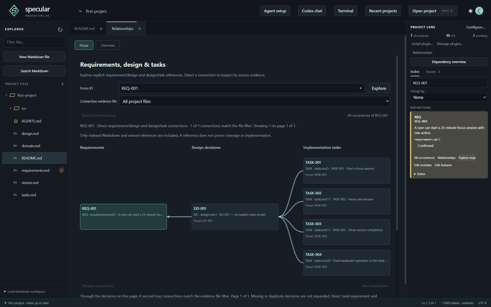

#  Specular

[](https://github.com/specular-ai/catalogue)

[](LICENSE)


> **Understand and steer agentic development.**

Specular is a desktop IDE for **abstraction-augmented agentic development (A³D)**: coding agents write the code, and developers stay in control through interactive abstractions of the project and its evolution, each traced back to its evidence.

Specular is Markdown-first. Requirements, design decisions and tasks live in ordinary Markdown files. Specular indexes the IDs in them, shows how they connect, renders their diagrams, and helps you hand reviewed context to coding agents such as Codex and Claude Code.



Specular is a research prototype for Windows, built with TypeScript and Electron.

## Abstractions and models

When coding agents write much of the code, developers need to keep track of what the project is meant to do and how it is evolving. A³D addresses this with **development abstractions**: task-oriented views that each answer a developer question, such as *which design decisions and tasks address this requirement?* (the project map above) or *where is this requirement defined, and what is its status?* (the ID cards in Project Lens).

Abstractions are built on **development models**, which are extracted from the project's artefacts and keep traces back to them. Specular currently builds a *project model* (IDs, their categories, statuses, modules, features and relationships) and a *physical model* (folders, files and current Markdown text). The same model can serve several abstractions, and every element of an abstraction leads back to the source text that supports it.

New abstractions are plugins: they declare the models they need and receive them through the plugin SDK. The [catalogue of development abstractions](https://github.com/specular-ai/catalogue) describes the abstractions and models in more detail, including ones not yet implemented, such as evidence coverage and agent activity maps.

## Getting started

You need Windows and [Node.js](https://nodejs.org/) 22.12 or later.

```powershell
npm.cmd ci
npm.cmd start
```

On the start screen, choose **Try the demo project** for an editable focus-timer example, or **Open project** to open a folder of your own. The demo's source is in [examples/first-project](examples/first-project/README.md), and its README is a guided tour of the features below.

## What you can do

- **Edit Markdown** with a live preview, several tabs and automatic saving. Files stay ordinary Markdown that you can version in Git and use without Specular.
- **Follow IDs across files.** IDs such as `REQ-001` or `DD-001` are indexed project-wide: Ctrl-click or F12 jumps to a definition, Shift-F12 lists references. **Project Lens** shows a card per ID with its status, module, feature and every occurrence.
- **Explore relationships.** Choose **Explore map** on a card for a focused requirement → design → task graph, or **Dependency overview** for every ID and connection. Each connection links to the source text that records it.
- **See diagrams.** Mermaid blocks (state machines, class diagrams, user journeys, flowcharts, ...) render in the preview and in a separate **Diagrams** view that links back to their source.
- **Find what is pending.** The **Issues** tab lists pending items, duplicate IDs and references to IDs that are never defined.
- **Configure your project's conventions.** In **Project Lens > Project configuration**, define ID categories and recognition rules, statuses, modules and features, or let a coding agent propose them. Settings are stored in `.specular/project.json`. See the [configuration guide](docs/project-ids.md).
- **Work with agents.** Open PowerShell, Command Prompt, Codex or Claude Code terminals in the project. Select text and choose **Prepare agent brief** to assemble an instruction with its source context, review it, then send it to the built-in read-only Codex chat or insert it into an agent terminal. Agent software is installed separately; the chat needs an OpenAI API key.
- **Extend it with plugins.** New views can be built against the public plugin SDK, without Specular's source, and installed from **Project Lens > Install plugin folder...**. See the [SDK guide](packages/plugin-api/README.md) and the [example plugins](examples/plugins/plugin-template/README.md).

Statuses, links and tasks show what the documents say, not verified facts about the implementation.

## Development

```powershell
npm.cmd run check        # Type checking, unit tests and build
npm.cmd run test:sdk     # Builds the plugin SDK and the example plugins the desktop tests install
npm.cmd run test:ui      # Desktop workflow tests; opens temporary windows
npm.cmd run package      # Unpacked desktop build under out/
```

Tests that make model requests are skipped unless explicitly enabled with an API key.

| Folder | Contents |
| --- | --- |
| `src/` | Application source: core analysis, Electron main process, renderer |
| `packages/plugin-api/` | Public plugin SDK |
| `bundled-plugins/` | Relationships views, shipped as a plugin |
| `examples/` | Demo projects and example plugins |
| `docs/` | User documentation |
| `tests/` | Unit and desktop tests |

## License

[MIT](LICENSE)
