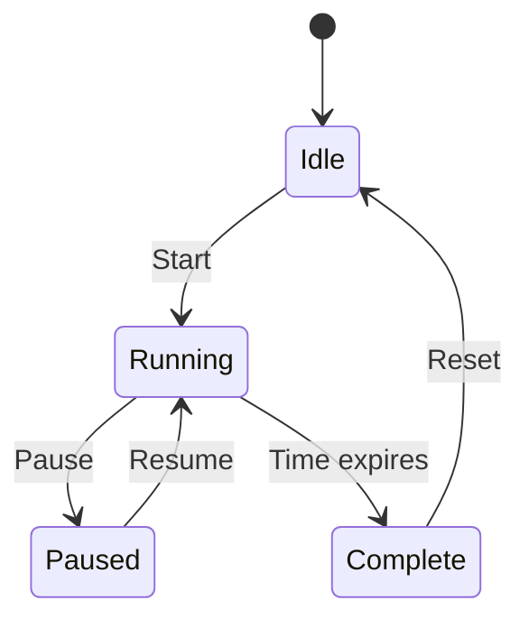

# Focus timer — design

## DD-001 — An explicit state model

Keep the timer's state separate from its presentation. This supports REQ-001, REQ-002, and REQ-003 without making the interface responsible for timekeeping.

## Timer states

Select **Diagrams** above to see this model separately. Use its source link to return to the Markdown.

## Next decision

REQ-004 is still open. Keep the completion signal independent of the state transition until its behavior is confirmed.
