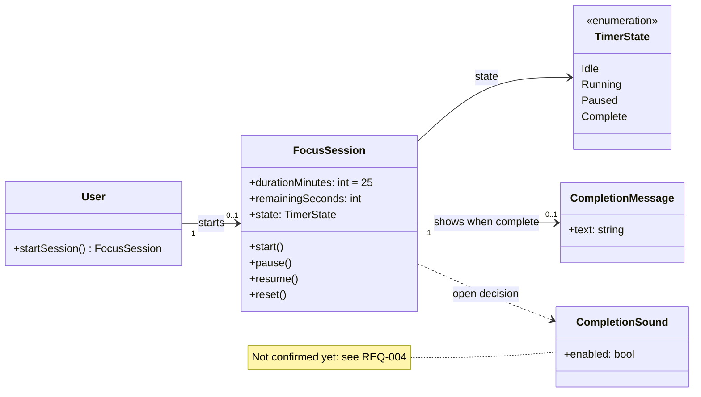

# Focus timer — domain model

The concepts behind the timer, their properties, and how they relate. The [design](design.md#timer-states) describes how a session moves between states; this page describes what a session is.

## Concepts

Select **Diagrams** above to see this model on its own, with a link back to its source.

## Where the concepts come from

- **FocusSession** lasts 25 minutes and starts with one action, as REQ-001 requires.
- **remainingSeconds** is kept while paused, so a session can resume without losing time (REQ-002).
- **TimerState** lists the states drawn in the design; DD-001 keeps them separate from the presentation.
- **CompletionMessage** is shown when time expires (REQ-003).
- **CompletionSound** has only a dashed dependency because REQ-004 is still open: it is a candidate concept, not a confirmed one.

The [implementation sketch](src/timer.ts) currently covers only the session's state and remaining time.
