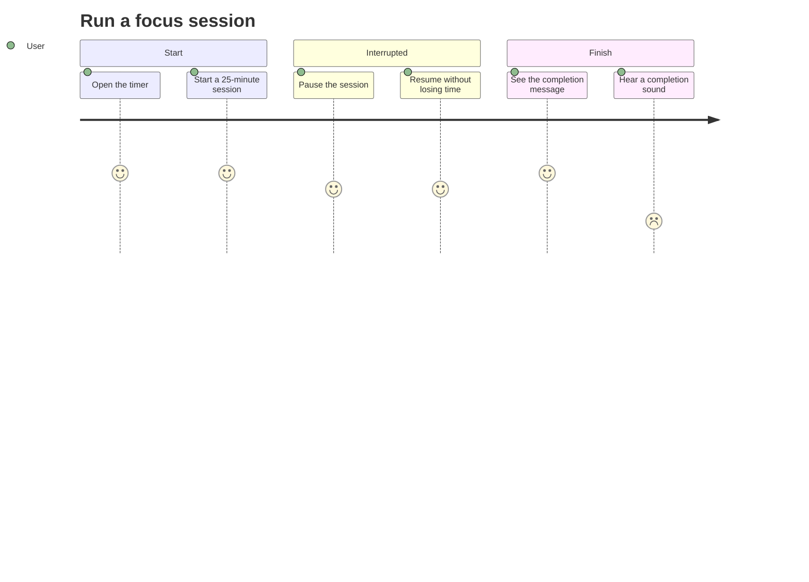

# Focus timer — user stories

How a user experiences the timer, from starting a session to finishing it. The [requirements](requirements.md) state what the timer must do; this page shows the journeys those requirements support.

## Stories

- As a user, I want to start a focus session with one action, so that I can begin working without setup (REQ-001).
- As a user, I want to pause and resume a session, so that an interruption does not cost me the time I have left (REQ-002).
- As a user, I want to be told when the session ends, so that I know when to take a break (REQ-003).

## Journey

Each step has a score from 1 (frustrating) to 5 (satisfying). Hearing a sound scores low because REQ-004 is still open: the journey shows it as a gap, not as confirmed behavior.

Select **Diagrams** above to see this journey on its own, with a link back to its source.
