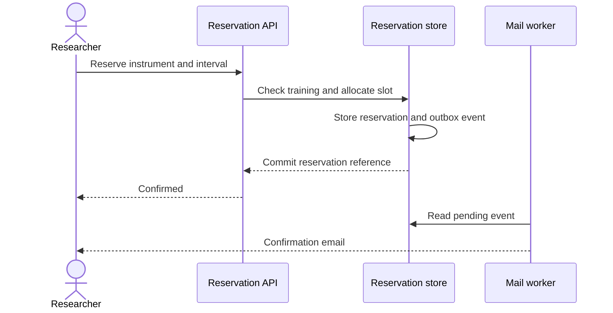

# Harbor / Reservation design

These decisions separate the reservation transaction from policy checks and message delivery. References record the rationale for each decision.

## DD-001 — Atomic slot allocation

Status: Accepted

Use a database transaction and an exclusion constraint on the instrument and time interval. Store an idempotency key with the result so that a retried request returns the same reservation.

This supports REQ-001 and enforces REQ-002 at the persistence boundary, including requests from different application instances. Use half-open intervals so consecutive bookings can share a boundary.

**Trade-off.** The database owns the final conflict decision. The client can suggest available slots, but must handle a conflict returned at confirmation time.

## DD-002 — Training policy gate

Status: Accepted

Evaluate instrument-specific training immediately before allocating a slot. Read the qualification in the reservation transaction and require validity through the requested end time. Record the qualification version used for the decision.

This provides the eligibility check required by REQ-001 and the expiry semantics in REQ-003. Return a structured rejection that the interface can explain without exposing another researcher's training records.

**Trade-off.** Reservations remain tied to the qualification evidence at confirmation. A later revocation enters coordinator review instead of silently deleting the booking.

## DD-003 — Transactional notification outbox

Status: Accepted

Write a notification event in the same transaction as the reservation. A background worker delivers the email and records a stable event identifier for deduplication. Retry transient delivery failures with bounded exponential backoff.

This keeps confirmation in REQ-001 independent of mail availability while supporting the delivery behavior in REQ-004. The booking page reads reservation state directly and never waits for the mail worker.

**Trade-off.** Email delivery is eventually consistent. Operations can inspect delayed messages and retry exhausted events without altering reservation state.

## Confirmation sequence

